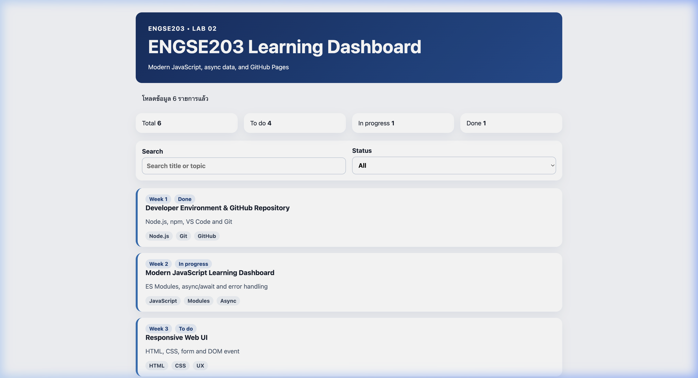
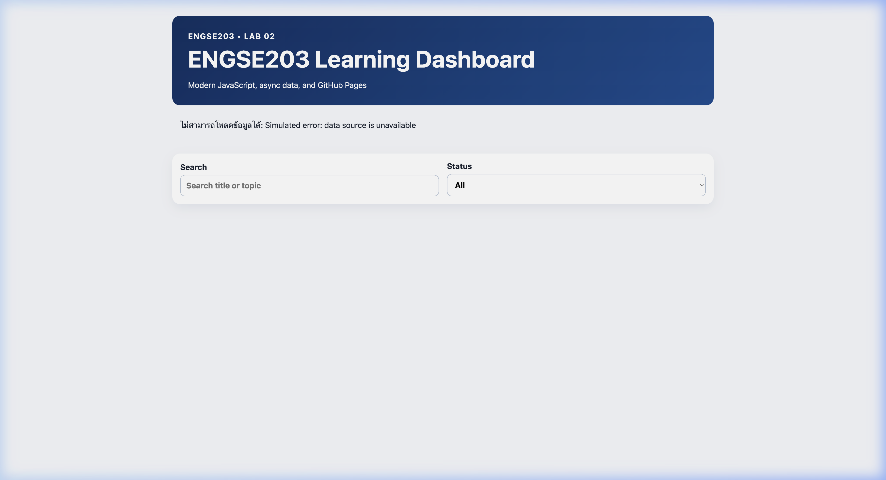

# Week 02 Evidence

หลักฐานภาพหน้าจอการทำงานของระบบ Modern JavaScript:

## 1. สถานะปกติ (Normal State)
ภาพหน้าจอแสดงรายการคำร้องและการโหลดข้อมูลสำเร็จ:

## 2. สถานะเกิดข้อผิดพลาด (Error State)
ภาพหน้าจอแสดงการจัดการ error เมื่อโหลดข้อมูลไม่สำเร็จ:

