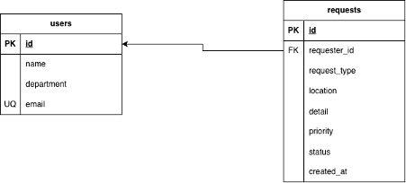

# DATA_MODEL — Campus Service Request / LAB09

## 1. ภาพรวม

ฐานข้อมูลเก็บผู้แจ้งใน `users` และคำร้องบริการใน `requests` เป็นความสัมพันธ์แบบ **หนึ่งต่อหลาย (1:N)** ผู้ใช้หนึ่งคนมีคำร้องได้ตั้งแต่ 0 รายการขึ้นไป แต่คำร้องแต่ละรายการต้องมีผู้แจ้งหนึ่งคน



`requests.requester_id` อ้างถึง `users.id` ด้วย Foreign Key ข้อมูลตั้งต้นมีผู้ใช้ 5 คนและคำร้อง 8 รายการ ผู้ใช้รหัส 5 ยังไม่มีคำร้องเพื่อใช้เปรียบเทียบ JOIN กับ LEFT JOIN ข้อมูลเดิม REQ-001 ถึง REQ-005 รวมทั้งเวลาเดิมได้รับการรักษาไว้ ส่วนรายการที่เพิ่มเป็นข้อมูลสมมติสำหรับทดสอบ

## 2. ทำไมต้องแยกเป็น 2 ตาราง

ใน Week 06–07 แต่ละคำร้องเก็บ `requesterName` เป็นข้อความ หากสมชายแจ้ง 20 รายการ จะเก็บชื่อซ้ำ 20 ครั้งและเกิดปัญหาต่อไปนี้

1. **ข้อมูลซ้ำ:** ชื่อผู้ใช้คนเดียวกันอยู่ในหลายคำร้อง หากเพิ่มอีเมลหรือภาควิชาก็ต้องเก็บซ้ำตามจำนวนคำร้อง
2. **แก้ไขไม่ครบ:** ถ้าสมชายเปลี่ยนชื่อ ต้องแก้ 20 รายการ หากลืมบางรายการจะมีทั้งชื่อเก่าและชื่อใหม่ปะปนกัน
3. **เพิ่มข้อมูลผู้ใช้ไม่สะดวก:** ถ้ามีข้อมูลผู้ใช้เฉพาะในคำร้อง จะเก็บผู้ใช้ที่ยังไม่เคยแจ้งไม่ได้โดยไม่สร้างคำร้องขึ้นมาก่อน
4. **ชื่อสะกดไม่ตรงกัน:** ชื่อที่พิมพ์ต่างกันในแต่ละคำร้องทำให้ไม่แน่ใจว่าเป็นคนเดียวกัน และคนละคนอาจมีชื่อเหมือนกันได้

เมื่อแยกตาราง ชื่อ อีเมล และภาควิชาเก็บครั้งเดียวใน `users` ส่วนคำร้องเก็บรหัส `requester_id` จึงเปลี่ยนชื่อสมชาย **เพียง 1 แถวใน users** คำร้องทั้ง 20 รายการจะแสดงชื่อใหม่เมื่อ JOIN โดยไม่ต้องแก้แต่ละคำร้อง Foreign Key ยังป้องกันการอ้างถึงผู้ใช้ที่ไม่มีจริง แต่ไม่ได้ตรวจว่าชื่อใน users สะกดถูก ต้องตรวจชื่อขณะบันทึกด้วย

## 3. รายละเอียดตาราง

### users

| คอลัมน์ | ชนิด | ข้อกำหนด | เหตุผล |
|---|---|---|---|
| id | INTEGER | PRIMARY KEY AUTOINCREMENT | ระบุผู้ใช้แต่ละคนด้วยเลขไม่ซ้ำ และให้ฐานข้อมูลสร้างเลขเมื่อไม่ได้ส่ง id |
| name | TEXT | NOT NULL | ต้องมีชื่อสำหรับแสดงผู้แจ้ง แต่ไม่กำหนด UNIQUE เพราะคนละคนอาจชื่อเหมือนกัน |
| department | TEXT | NOT NULL | ใช้ระบุและกรองคำร้องตามภาควิชา |
| email | TEXT | NOT NULL UNIQUE | ต้องมีอีเมลและไม่ให้อีเมลเดียวกันลงทะเบียนซ้ำ |

### requests

| คอลัมน์ | ชนิด | ข้อกำหนด | เหตุผล |
|---|---|---|---|
| id | TEXT | PRIMARY KEY NOT NULL | เก็บรหัสที่อ่านได้ เช่น REQ-001 และป้องกันรหัสซ้ำหรือ NULL |
| requester_id | INTEGER | NOT NULL, FOREIGN KEY REFERENCES users(id) | ทุกคำร้องต้องอ้างถึงผู้ใช้ที่มีอยู่จริง และใช้ชนิดเดียวกับ users.id |
| request_type | TEXT | NOT NULL, CHECK IN ('แจ้งซ่อม', 'บริการบัญชีผู้ใช้', 'ขอใช้อุปกรณ์', 'อื่น ๆ') | จำกัดประเภทให้ตรงตัวเลือกที่ระบบรองรับ |
| location | TEXT | NOT NULL | ต้องระบุสถานที่เพื่อให้เจ้าหน้าที่ดำเนินงานได้ |
| details | TEXT | NOT NULL | ต้องมีรายละเอียดคำร้อง |
| priority | TEXT | NOT NULL, DEFAULT 'normal', CHECK IN ('normal', 'urgent') | ใช้ความเร่งด่วนปกติเมื่อไม่ระบุ และป้องกันค่าที่ระบบไม่รู้จัก |
| status | TEXT | NOT NULL, DEFAULT 'pending', CHECK IN ('pending', 'in-progress', 'completed') | คำร้องใหม่เริ่มจาก pending และจำกัดสถานะที่เปลี่ยนได้ |
| created_at | TEXT | NOT NULL, DEFAULT datetime('now', 'localtime') | เก็บเวลาสร้างรูปแบบ YYYY-MM-DD HH:MM:SS เพื่อเรียงคำร้องล่าสุด |

`NOT NULL` ป้องกันค่า NULL และการละคอลัมน์ที่ไม่มี DEFAULT แต่ยังยอมรับข้อความว่าง `''` จึงต้องตรวจข้อความว่างหรือช่องว่างที่ชั้น API ด้วย ข้อกำหนดใน Lab นี้ไม่ได้เพิ่ม CHECK สำหรับความยาวข้อความ

เวลาของข้อมูลตั้งต้นระบุแน่นอนเพื่อให้สร้างฐานข้อมูลใหม่แล้วได้ผล query เดิม ส่วนคำร้องใหม่ที่ไม่ระบุเวลาจะใช้เวลาท้องถิ่นของเครื่องที่เปิดฐานข้อมูล ใน Week 10 ควรใช้รูปแบบและเขตเวลาเดียวกันทั้งระบบ

มี index `idx_requests_status` สำหรับกรองสถานะ และ `idx_requests_requester` สำหรับค้นคำร้องของผู้ใช้และ JOIN การมี index ใช้พื้นที่เพิ่มและทำให้การเขียนมีงานเพิ่ม จึงเลือกเฉพาะคอลัมน์ที่ค้นบ่อย ไม่ได้สรุปว่าเร็วขึ้นจากข้อมูลเพียง 8 แถว

## 4. เหตุผลของการเลือกชนิดและข้อกำหนด

### ทำไม users.id และ requests.id ใช้ชนิดต่างกัน

`users.id` ใช้ INTEGER เพราะเป็นรหัสภายในที่ให้ฐานข้อมูลเพิ่มเลขได้ ส่วน `requests.id` ใช้ TEXT เพราะรหัสคำร้องมีตัวอักษรและเครื่องหมาย เช่น REQ-001 ซึ่งเก็บเป็นจำนวนเต็มไม่ได้ `requester_id` เป็น INTEGER เพื่ออ้างถึง `users.id`

ใน SQLite ตารางปกติ การประกาศ `TEXT PRIMARY KEY` อย่างเดียวไม่ได้ป้องกัน NULL เสมอ จึงเพิ่ม `NOT NULL` ให้รหัสคำร้องและทดสอบการปฏิเสธ NULL เพิ่มเติม

### ทำไมต้องมี CHECK แม้ API ตรวจข้อมูลแล้ว

ข้อมูลอาจถูกเขียนจาก SQLite extension, SQL โดยตรง หรือโปรแกรมอื่นที่ไม่ได้ผ่าน API ถ้าไม่มี CHECK ค่าอย่าง `status = 'ยกเลิก'` อาจหลุดเข้าฐานข้อมูลได้ CHECK เป็นกฎที่บังคับกับทุกช่องทาง ส่วนการตรวจที่ API ยังช่วยตอบข้อความผิดพลาดที่ผู้ใช้เข้าใจง่าย ทั้งสองชั้นทำหน้าที่ร่วมกัน

Foreign Key ต้องเปิดด้วย `PRAGMA foreign_keys = ON` **ทุกครั้งที่เปิด connection** ค่านี้ไม่ได้บันทึกเป็นการตั้งค่าถาวรใน campus.db การมี FOREIGN KEY ใน schema เพียงอย่างเดียวยังไม่พอ

## 5. ตัวอย่างการใช้ JOIN

คำสั่งนี้เชื่อมคำร้องกับผู้แจ้งด้วยรหัสที่ตรงกัน และตั้งชื่อคอลัมน์ให้ตรงกับรูปแบบ API

```sql
SELECT r.id, u.name AS requesterName, r.status
FROM requests AS r
JOIN users AS u ON u.id = r.requester_id
ORDER BY r.id;
```

ผลจาก `campus.db` หลังทำ TakeHome:

| id | requesterName | status |
|---|---|---|
| REQ-001 | สมชาย ใจดี | pending |
| REQ-002 | สุภาวดี รักเรียน | in-progress |
| REQ-003 | ธนกฤต ตั้งใจ | completed |
| REQ-004 | สมชาย ใจดี | pending |
| REQ-005 | ปรียา ขยันยิ่ง | pending |
| REQ-006 | สุภาวดี รักเรียน | pending |
| REQ-007 | ธนกฤต ตั้งใจ | in-progress |
| REQ-008 | ปรียา ขยันยิ่ง | completed |

`ON u.id = r.requester_id` ทำให้แต่ละคำร้องจับคู่กับเจ้าของจริง ถ้าจับคู่ทุกแถวโดยไม่กำหนดเงื่อนไขจะได้ 8 × 5 = 40 แถว แทนคำร้องจริง 8 แถว

Challenge ใน `queries.sql` ใช้ LEFT JOIN เพื่อให้วิภา (id 5) ซึ่งยังไม่เคยแจ้งปรากฏพร้อมจำนวน 0 ด้วย ต้องใช้ `COUNT(r.id)` เพราะนับเฉพาะคำร้องที่จับคู่ได้ ส่วน `COUNT(*)` จะนับแถวของผู้ใช้ที่ไม่มีคำร้องเป็น 1

## 6. ข้อสังเกตสำหรับสัปดาห์ที่ 10

Week 07 API เก็บคำร้องในหน่วยความจำและส่ง `requesterName`, `requestType`, `location`, `details`, `priority` และ `status` ให้ React แม้ฐานข้อมูลใหม่แยกผู้แจ้งกับคำร้องออกจากกัน แต่ JOIN และ AS สามารถรวมกลับเป็นข้อมูลรูปแบบเดิมได้ เช่น

```json
{ "id": "REQ-001", "requesterName": "สมชาย ใจดี", "status": "pending" }
```

query ⑤ ใน `queries.sql` เลือกคอลัมน์ครบตามคำร้องของ Week 07 และเปลี่ยน `request_type` เป็น `requestType` ด้วย ดังนั้นโครงสร้างการจัดเก็บไม่จำเป็นต้องเหมือนข้อมูลที่ส่งออก ชั้น service เป็นจุดที่ดึงและรวมข้อมูล ส่วน controller, route และ React สามารถใช้รูปแบบผลลัพธ์เดิมได้เมื่อ service รักษาสัญญา API เดิม

การสร้างคำร้องต้องแปลงผู้แจ้งเป็น `requester_id` ที่มีจริง และกำหนดว่าจะเลือกหรือสร้าง users อย่างไร ส่วนการลบผู้ใช้ที่ยังมีคำร้องจะถูก Foreign Key ปฏิเสธ เพราะ schema ไม่ได้กำหนด ON DELETE CASCADE ต้องจัดการคำร้องที่เกี่ยวข้องก่อนหากต้องการลบผู้ใช้นั้น

## 7. ผลทดสอบและไฟล์ประกอบ

รันตัวตรวจจากโฟลเดอร์ `labs/week-09/source/`:

```bash
node --disable-warning=ExperimentalWarning check-week09.mjs
```